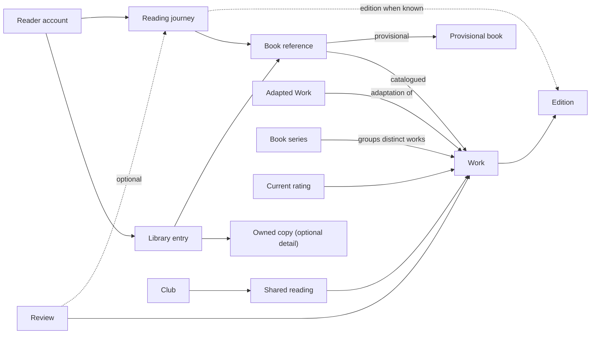

# Cemiyet Domain Model

Status: **Domain baseline complete; ownership revised after the independent module review on 2026-11-09.**
Updated: 2026-11-09.

This model defines the accepted business identities, ownership, invariants and lifecycles, alongside the [product scope](../planning/product-scope.md). Software module/layer design is recorded separately in the [revised architecture](../architecture/system.md). Responsibility refinements preserve the agreed business meanings.

## Vocabulary and documentation ownership

The local [glossary](../../GLOSSARY.md) supplies all required terminology in this checkout. Shared vocabulary originates in `cemiyet/backend:GLOSSARY.md` and this model in `cemiyet/backend:docs/domain/model.md`; `cemiyet/frontend` carries self-contained copies with the same relative layout. Keep shared meanings synchronized when both repositories are available. Agent domain instructions identify the editing authority; another checkout is not required to read this model.

Glossaries contain definitions only. Invariants, workflows, candidate ownership, and open questions belong here. ADRs are created only for decisions meeting the domain-modeling trade-off criteria; none is needed just to start the glossary.

## Agreed conceptual identities

| Concept | Identity and meaning | Distinction to preserve |
| --- | --- | --- |
| Work | A book-level creation independent of its published editions. | ISBN is not its internal identity. Substantial adaptations are distinct related Works; ordinary translations are Editions of the Work. |
| Edition | A particular published version/form of a Work. | An unchanged reprint is not automatically another Edition. Known external identifiers are typed, sourced links. |
| Owned copy | A reader's optional separately tracked instance. | Equal ISBNs do not mean equal personal copies; no copy count is invented for simple ownership. |
| Provisional book | A private unresolved book identity, usable before catalog admission. | It is not automatically a public Work or Edition. Resolution preserves personal associations/history. |
| Reading journey | One reader's distinct attempt, with independent progress and outcome. | Explicit concurrent journeys for the same Work are allowed; rereads do not add aggregate rating votes. |
| Current rating | One current public evaluation for an account and canonical Work. | Historical reviews and private notes do not silently change it. |
| Reader account | The actor controlling personal records and login methods. | It is not the catalog Author identity or Publisher organization. |
| Author identity | A public credited identity/pseudonym. | Claiming it is a verified association, not proof of ownership over reader opinions. |
| Publisher record | Bibliographic publisher/imprint identity. | Publisher organization is the separately managed participant in Cemiyet. |
| Club | A membership-based shared-reading community. | Joining/following does not own a member's personal reading journey or grant private-library access. |

Every identity has an internal life independent of a mutable title, display name, email address, ISBN string, or external provider ID.

## Core relationship sketch

A book reference selects a catalogued or provisional identity; it is not permission to pretend both are verified. The diagram is semantic, not a database schema. Public rating/review publication requires an accepted Work; an unknown Edition alone does not block evaluation of an accepted Work. Private notes/readings continue while the Work is provisional.

## Accepted invariants

1. **Identity and source evidence:** public catalog admission needs the applicable publication identifier or reviewed alternative evidence. A private unresolved entry remains usable. ISBN syntax validity, source matching, and public approval are separate facts.
2. **Preserved ownership of facts:** external refreshes do not silently overwrite approved catalog corrections. Imports reuse source data, preserve deliberate personal edits, and retain uncertainty rather than inventing it.
3. **Independent personal relationships:** ownership, reading intention, journey state, and custom-list membership are distinct. Removing one does not delete the others.
4. **Optional complexity:** simple ownership does not require copy, edition, format, or quantity. A detailed record exists only when actual detail is supplied or deliberately established.
5. **Independent journeys:** an explicit new attempt creates another journey. Continuing after a pause retains its journey. Import/retry duplication is not a new attempt; matching ISBNs alone do not collapse real rereads.
6. **Progress is evidence, not invention:** optional observations use an applicable unit. Recording only start/completion is valid. A position does not prove time spent; a missing total cannot produce an exact percentage.
7. **Temporal precision:** recording/import time differs from the historical reading date. Preserve unknown/year/month/day precision. A dated summary includes a reading only when available evidence supports its period placement.
8. **Ratings and review history:** public ratings use 0.5–5 stars in half-star steps; unrated is not zero. A reader explicitly changes the one current Work rating. Separate reviews can keep per-journey and edition context without extra votes.
9. **Aggregate score eligibility:** deleted-account contributions leave current averages/counts. A catalog merge preserves histories and selects the latest eligible explicit public-rating action per account for the canonical Work; it does not average that person's old votes. A stable tie-break plus review flag handles equal action timestamps. Affected public aggregates show an updating state until reconciliation is complete rather than knowingly counting duplicate votes.
10. **Deliberate publication:** private reading/library/note changes are not automatically public activities. Recurring publication follows explicit preferences. Comments, previews, search, notifications, and platform links obey current access; a child item cannot widen a protected parent.
11. **Private signals:** personalized use of private activity is for its owner when enabled. Initial public trends/social reading indicators use public signals only.
12. **Club autonomy and roles:** shared readings are club records; each reader controls their personal journey. Membership admission, content visibility, and discoverability are separate. Departure/removal revokes member-only access, including earlier threads.
13. **Scoped authority:** owner/manager/moderator/member are distinct club roles. Author/publisher status is not a moderation privilege; a personal block does not silently remove club duties. Club expulsion, posting limits, and security suspension are different actions.
14. **Personal deletion:** personal content/records are removed under the confirmed policy; independent bibliographic facts and other members' content survive. Last-owner deletion uses handover/archive rather than indefinite personal-data retention. Scoped necessary retention/evidence exceptions require an explicit policy.
15. **Derived information:** correcting or deleting readings changes current goals/statistics. Previously distributed external artifacts are not retroactively editable. Operational analytics is distinct from a reader's own summary.

## Domain responsibilities and aggregate model

These areas describe adopted responsibility, not software project names. The whole reader/library/club history is not one growing aggregate. Records with independent lifecycles stay independently addressable; historical observations can be queried without loading an entire reader history.

| Responsibility area | Roots/owned records | Owns | References without taking ownership |
| --- | --- | --- | --- |
| Bibliographic catalog | Work, Edition, Author identity, Publisher record; owner-private Provisional book | Bibliographic identity, private unresolved metadata, credits/provenance, accepted metadata, canonical redirects. Private provisional identity does not imply submission or saving/ownership. | Personal copies, readings, ratings, account claims. |
| Catalog contribution and recognition | Catalog contribution; contribution credit/badge award | Proposal/evidence, review outcome, accepted target, useful-contribution recognition and its rule/evidence/revocation. | Submitter and private source record; no personal history copied into the public proposal. Personal credit/attribution is erased with the account. |
| Personal library | Library entry; optional Owned copy; Loan; Custom list | Saved relationship, optional ownership detail, overlapping lists and simple lending record. | Catalog accepted/provisional identities and optional borrower account. No ownership of reading intention. |
| Reading | Reading intention; Reading journey; Personal note; Personal reading goal; Reading summary | Intent/outcome/temporal precision, progress, private annotations, personal goals/statistics and summary meaning. | Reader and Catalog accepted/provisional identity; optional Edition/club context. No saved/owned Library entry required. |
| Reviews | Review; current rating scoped to reader/work | Authored evaluation, optional historical context, current public score intent. | Catalog identity and optional journey/edition. |
| Accounts and organizations | Reader account; Reader profile; Author claim; Publisher organization; account-erasure workflow | Login/session associations, public presentation, claim/membership state, account exit and data-owner erasure receipts. | Catalog Author/Publisher identities; owners erase their own data. No ownership of their full records. |
| Clubs | Club; shared reading; gathering | Membership/role decisions and shared resources. | Individual readers/journeys, without automatically editing them. |
| Publication and discussion | Published activity; discussion/comment as bounded records | Deliberate publication and contextual conversation. | The authoritative source content and audience; copied previews are not permission authority. |
| Shared challenges (M8) | Reading challenge; challenge participation | Shared campaign rules/windows, opt-in participation and results; optional Club scope. | Reading evidence and optional membership. Personal goals remain in Reading; contribution recognition remains in Catalog. |
| Moderation | Moderation case/action | Scoped report, evidence, decision/reason, appeal and sanction state. | Target content/account/membership; no blanket private-data access or account-erasure coordination. |
| Portability | Owner-scoped import batch; export package | Transfer mapping/preview/confirmation, row receipts, export manifest and temporary-file lifecycle. | Catalog/personal identities through owner operations or authorized export participants. No duplicate source-data authority. |
| Discovery | Derived search and recommendation views | Search representations, explicit/inferred discovery preferences and recommendation results. | Authoritative catalog/content/access decisions. Reading owns personal reading-statistic meaning; discovery is not a new owner of reading history. |

Likely value concepts include book reference, optional edition selection, partial reading date, typed progress measurement, star rating, external identifier with provenance, sharing audience, and goal metric. Their exact representation belongs to the model/architecture review.

## Lifecycle rules

| Lifecycle | States/actions | Rules |
| --- | --- | --- |
| Reading journey | Reading, Paused, Completed, Abandoned; Start, Continue, Pause, Complete, Abandon, Correct, StartAgain. | Continue explicitly resumes Paused/Abandoned without another journey. StartAgain creates a new identity. Completed is changed only by explicit correction, never overwritten by a reread. Historical completed entry is direct. |
| Progress | Record/correct an observation; optional total and unit. | Percentage is 0–100; page/time positions are nonnegative. Missing totals stay unknown. A position beyond suspect catalog metadata is flagged for correction, not silently discarded. Completion is explicit and need not invent a final page observation. |
| Library/copy | Saved/removed association; ownership/disposition; optional copy detail. | Removing ownership/list membership does not delete journeys. Do not infer a quantity or create imaginary copies for simple ownership. |
| Loan | Active, Returned, Lost, Cancelled. | Simple book/person/optional-date note suffices. An identified copy permits one active loan; enforce in the owning library operation. Unknown-copy loans do not assert inventory quantities. No reservation/wait-list/fulfillment platform is introduced. |
| Catalog contribution | Submitted, NeedsInformation, Accepted, Rejected, Withdrawn. | Only authorized review accepts public data. Amendments retain evidence/history. Acceptance resolves private references without regenerating reading/copy identities. |
| Catalog merge | Proposed, Reconciling, Completed, RetryRequired. | Confirm duplicate identity, preserve aliases/provenance/history, reconcile current ratings, and expose an updating state if interrupted. Adaptations/series members are not duplicate editions. |
| Review | Draft, Published, Withdrawn, Removed. | Drafts/private notes remain personal; publishing requires accepted Work, verified account, and permission. Missing Edition does not block a known Work. Retracting a public review does not delete a personal journey. Explicit current-rating action remains independent. |
| Club/membership | Active or Archived club; invitation/application and Active/Left/Removed membership. | One active owner for an active club. Owner transfers explicitly; if deletion leaves no eligible accepted successor, archive read-only instead of blocking deletion. Archived clubs retain current members' authorized history, not access for former members. |
| Goals/challenges | Defined metric/period; opt-in participation, optional published progress. | Count evidence-supported completions in the declared period; distinguish rereads/distinct Works. Sharing challenge progress is explicit and does not reveal private book names. Corrections update current totals. |
| Contribution badge | Awarded, Revoked. | Award useful accepted contribution under a rule version. Preserve valid credit across catalog merges. Fraud/revoked acceptance may revoke an award with a reason; a harmless merge is not itself revocation. |
| Account/deletion | Active/security lock/deletion requested; participant erasure; completed. | Prove account control for linking/removal/recovery; prevent removing the last usable login method without replacement. Erasure revokes access first and finishes only after personal-data owners acknowledge completion; legal/security exceptions are purpose-scoped. Restore must reapply deletion decisions. |

These lifecycle rules refine the agreed product behavior. Exact database constraints, timestamps, protocol representation, limits, and retention durations belong to architecture/implementation acceptance.

## Identity, relation, and reconciliation decisions

- AdaptationOf relates distinct Works. Book-series membership is a separate relation with optional order; neither merges member Works or their ratings. Collections/box sets are reviewed as their own book-level Work where appropriate, with contained-work relations; no automatic title-based flattening.
- ISBN/source identifiers are namespaced links with provenance and verification state. A Work, Edition, credited identity, publisher, copy, and private provisional entry keep their own internal identities.
- A known ISBN need not produce metadata/cover from every provider. Lack of enrichment does not prove that a user-owned book is nonexistent.
- Public admission uses applicable identifier or reviewed evidence. Preserve private source data; only deliberately submitted bibliographic fields/evidence enter the catalog review.
- Resolving a private book or public duplicate preserves original personal identities and histories. Do not collapse rereads/copies based on matching Work/ISBN. Coalesced book views are not permission to erase distinct records.
- A public evaluation of an unknown Work waits for admission. An accepted Work remains reviewable while an optional Edition proposal is pending; unapproved Edition metadata is not presented as verified catalog fact.
- Current rating uses the latest eligible explicit public action for the canonical Work. Historical opinions remain history. Merge/deletion reconciliation never converts private notes into a public vote.

## Club authority baseline

| Role | Permitted scope | Exclusions |
| --- | --- | --- |
| Owner | Settings, roles, handover/archive, membership administration, and club-content moderation with reasons. | No outside-club authority, rating manipulation, or private-reader access. |
| Manager | Club settings/events/shared readings, invitations/applications, and member administration within assigned scope. | No unilateral ownership transfer, owner removal, or platform-wide sanctions. |
| Moderator | Club-content review, reports, recorded moderation actions, and escalation. | No automatic manager/owner promotion or account suspension. |
| Member | Authorized reading/discussion, opt-in participation, and attendance actions. | No implicit access to other members' private libraries or progress. |
| Platform moderator | Authorized case/appeal handling and scoped platform sanctions. | No blanket access to unrelated private notes/history. |

Public metadata, membership admission, and member-only content are checked separately. A reply cannot widen the parent audience. Personal blocks restrict direct interaction, while legitimate club moderation remains possible and auditable. Author/publisher status never adds moderation authority by itself.

## Cross-area consistency rules

1. The responsible owner validates and changes its own records. Other areas use explicit operations/results and identities, not another area's persistence model.
2. Source content is authoritative for current access. Feed/search/notification previews and media links cannot grant permission merely because an old copy or event exists. On uncertainty, protected content is withheld.
3. Current-rating uniqueness, identified-copy loan uniqueness, and owner-authorized state changes are immediate invariants in their owning operation.
4. Rebuildable discovery/insight projections can lag. Known stale permission/erasure states must not be treated as authorization. Affected merged scores show updating until reconciled.
5. Erasure and catalog reconciliation are explicit retryable workflows with stable operation identities, progress, and completion receipts. A retry is not a second loan, journey, vote, message, or award.
6. Notifications guide recipients without silently writing their libraries/readings. Imported files are temporary owner-only material, not an indefinite analytics/log archive.
7. Derived summaries use the underlying date precision and audience. External downloaded copies cannot be revoked through platform access controls.

## Structural scenarios

| Scenario | Agreed behavior |
| --- | --- |
| A novel has translations and a substantially rewritten adaptation. | Ordinary translations remain Editions; a substantial adaptation is a separate related Work. Adaptation and series relations are distinct. |
| A reader compares two translations concurrently. | Explicit separate journeys for the same Work are allowed. A retry/edition-detail edit does not create another attempt. |
| A reader privately records a completely unknown Work. | Private use continues; public evaluation waits for Work admission. An unknown optional Edition alone does not block evaluation of an accepted Work. |
| A reader lends a book without inventory detail. | A lightweight book/person note is valid without fabricated copies/quantities. One active-loan rule applies when an actual copy is identified; no reservation system is implied. |

## Completion and next phase

The domain baseline is complete: canonical terms, identities, structural scenarios, ownership, invariants, and lifecycle rules are recorded. Subsequent implementation evidence may refine representation without silently changing these product meanings. The glossary is updated whenever language resolves.

The [module ownership in the architecture](../architecture/system.md) assigns personal goals to Reading, contribution recognition and private provisional identity to Catalog, erasure coordination to Accounts, conduct cases to Moderation and transfers to Portability. Library and Reading remain independent consumers of book identity. Shared Challenges is a distinct M8 owner rather than a generic Engagement container.

The accepted roadmap is unchanged. Architecture enforcement is an implementation-time obligation: add relevant architecture and behavioral tests with actual code, not speculative scanner fixtures during planning. The [accepted roadmap](../planning/roadmap.md) and [local task queue](../../.scratch/architecture-roadmap/spec.md) define implementation order and prerequisites.
